# 解析結果（analysis）

Updated: 2026-11-16

[analysis-plan.md](analysis-plan.md) の項目に沿って、前処理済みのファイル（`wav/aligned/*.wav`）を解析した結果をまとめる。

- スクリプト：`tools/analyze.py`
- 図：`docs/figures/*.png`
- 数値の一覧：`docs/metrics.csv`
- ペダルごとにまとめ直したもの：[pedals.md](pedals.md)

対象は、Hudson Electronics Broadcast AP-II（Germanium / Silicon）、BOSS DS-1W（S-mode）、MXR Distortion+、Vin-Antique PPSE Classic、Strymon Riverside（3 設定）、BOSS SD-1W（S-mode）、Xotic Soul Driven の 10 台と、ペダルなしの Raw。以下では短縮名で書く（対応は [pre-process.md の「対象ペダルと表記」](pre-process.md#対象ペダルと表記) を参照）。

```sh
uv run --with numpy --with scipy --with soundfile --with matplotlib --with librosa python tools/analyze.py
```

## 音源について分かったこと

- 音源は、単音（基音 221.1Hz、A3 付近）を 1 回鳴らして減衰させたもの。Ditto 2 に録音した同じループを毎回再生しているため、全ファイルで演奏は同じ
- 全ファイルで 5〜6kHz より上がほぼない。録音経路にある DSM & Humboldt Simplifier MK-II のキャビネットシミュレーションで高域がカットされていると考えられる（録音経路は [pre-process.md の「録音経路」](pre-process.md#録音経路) を参照）。そのため、帯域と倍音の解析は 5kHz までを対象にした
- 全ファイルに 110Hz 付近の成分が弱く入っている。弾いていない 5 弦（開放 A、110Hz）の共鳴と考えられる
- 全ペダルとも、ゲインと EQ のつまみは 12 時で録音した。録音後、ペダルごとに音の大きさが違ったため、Logic Pro で Gain プラグインを挿し、ピークが同程度になるように調整してある。Riverside は Mid Push と High/Low のトグルを切り替えた 3 通り（組み合わせは [pre-process.md](pre-process.md) を参照）

## 要約

| 観点 | 結果 |
|---|---|
| 歪み・圧縮の強さ | 強い順に Soul Driven、DS-1W、SD-1W、Distortion+。Broadcast（Ge / Si）と Riverside low は Raw に近い |
| 音色 | SD-1W と PPSE Classic は中域（500Hz–1k）が持ち上がり、低域が減る。DS-1W は高域（2–5kHz）の割合が最も大きい。Distortion+ は低域が最も多い。Broadcast Si は高域の割合が最も小さい |
| アタック | Soul Driven（15ms）と SD-1W（14ms）はなだらか。Riverside と PPSE Classic は Raw と同じくらい鋭い（2〜3ms） |
| 倍音 | ペダルによる差は主に 9 次以上（2kHz 以上）に出る。2〜8 次は Raw にもともとある倍音（ギターと録音経路による）が大きく、差は小さい |
| ノイズ | Soul Driven が最も多い（-55.1dBFS）。目立つハムはどのファイルにもない |
| 系統分け | ①Raw・Riverside low（ほぼクリーン）、②Broadcast・PPSE Classic・Riverside low-mid / high（低〜中ゲイン）、③DS-1W・Distortion+・SD-1W（高ゲイン）、④Soul Driven（単独） |

## A. 周波数特性

### A1. 平均スペクトル

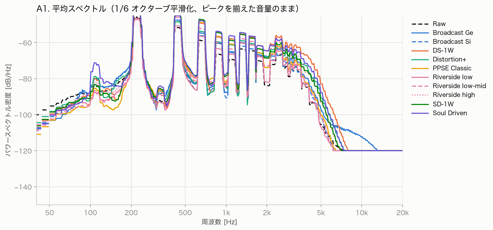

- 221Hz とその整数倍に鋭いピークが並ぶ（単音の倍音）
- 歪みの強いペダルほど、2〜5kHz のレベルが高い
- Broadcast Ge だけ 7〜12kHz に成分がある。スペクトログラム（B1）を見ると立ち上がりの瞬間だけに出ている

### A2. Raw とのスペクトル差分

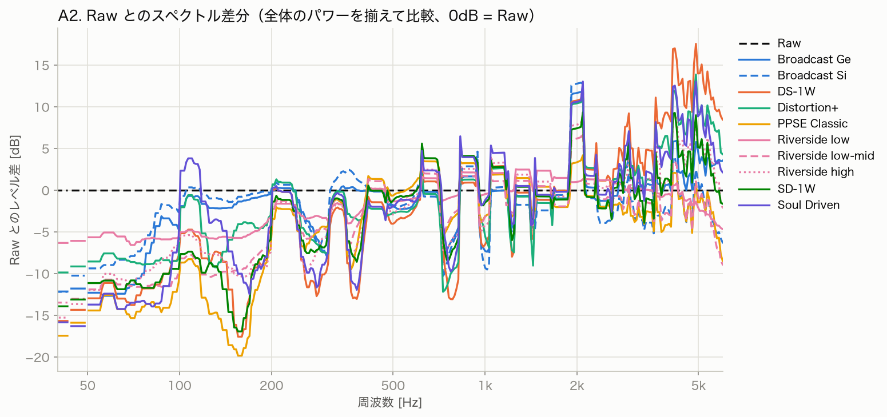

ピークを揃える調整の影響を除くため、全体のパワーを揃えてから Raw と比べた。

- 2–5kHz の持ち上がりは DS-1W が最も大きく（平均 +6.8dB、4.9kHz 付近で最大 +17.5dB）、Distortion+（平均 +4.3dB）、Soul Driven（平均 +4.2dB）が続く
- 150Hz 付近は、PPSE Classic（約 -20dB）、DS-1W（約 -18dB）、SD-1W（約 -17dB）が大きく削れている
- 80Hz より下は、全ペダルで Raw より 6〜15dB 小さい
- 110Hz 付近は、ほかのペダルが Raw より 0〜9dB 小さいのに対し、Soul Driven だけ約 3.5dB 大きい。110Hz 付近の成分（5 弦の共鳴）は元の音に含まれており、Soul Driven はそれを相対的に強く通している。回路の 120Hz 付近の持ち上げによると考えられる（[pedals.md の Soul Driven](pedals.md#xotic-soul-driven)）

### A3. 帯域別エネルギー比

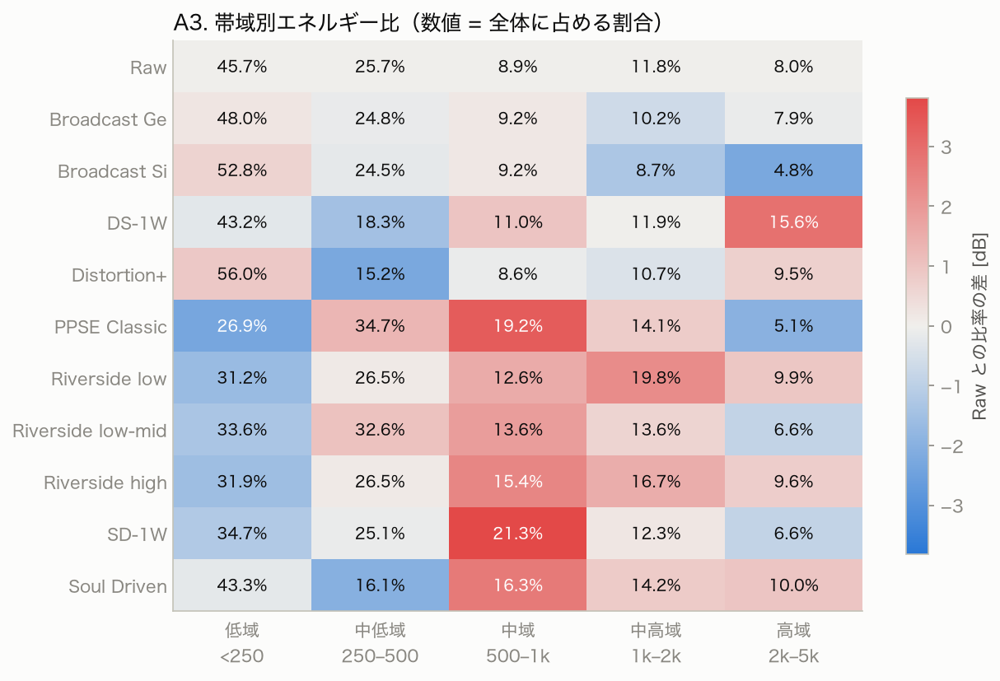

| ペダル | <250 | 250–500 | 500–1k | 1k–2k | 2k–5k |
|---|---:|---:|---:|---:|---:|
| Raw | 45.7% | 25.7% | 8.9% | 11.8% | 8.0% |
| Broadcast Ge | 48.0% | 24.8% | 9.2% | 10.2% | 7.9% |
| Broadcast Si | 52.8% | 24.5% | 9.2% | 8.7% | 4.8% |
| DS-1W | 43.2% | 18.3% | 11.0% | 11.9% | **15.6%** |
| Distortion+ | **56.0%** | 15.2% | 8.6% | 10.7% | 9.5% |
| PPSE Classic | 26.9% | **34.7%** | 19.2% | 14.1% | 5.1% |
| Riverside low | 31.2% | 26.5% | 12.6% | **19.8%** | 9.9% |
| Riverside low-mid | 33.6% | 32.6% | 13.6% | 13.6% | 6.6% |
| Riverside high | 31.9% | 26.5% | 15.4% | 16.7% | 9.6% |
| SD-1W | 34.7% | 25.1% | **21.3%** | 12.3% | 6.6% |
| Soul Driven | 43.3% | 16.1% | 16.3% | 14.2% | 10.0% |

- 中域を持ち上げる（TS 系に近い傾向）：SD-1W、PPSE Classic、Riverside の 3 設定。いずれも低域が Raw より 11〜19 ポイント少ない
- 高域の割合が大きい：DS-1W（2–5kHz が Raw の約 2 倍）
- 低域が多い：Distortion+、Broadcast Si
- Raw に近い：Broadcast Ge
- Riverside の Mid Push をオンにすると（low → low-mid）、250–500Hz の割合が 26.5% から 32.6% に上がり、1k–2kHz の割合が 19.8% から 13.6% に下がる。High/Low トグルを High にしても（low → high）、帯域バランスはほとんど変わらない（各帯域の差は 3.1 ポイント以内）

## B. 時間変化

### B1. スペクトログラム

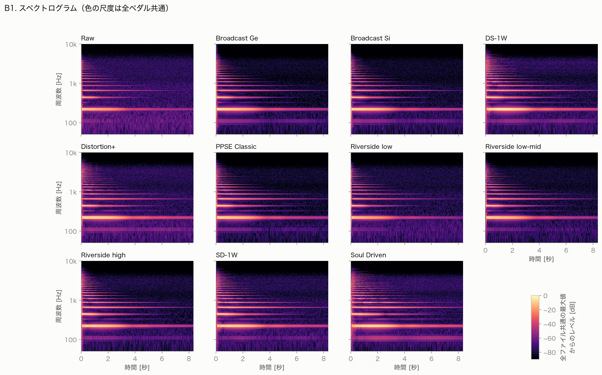

- 歪みの強いペダル（DS-1W、Distortion+、SD-1W、Soul Driven）ほど、高次の倍音が長く残る
- Soul Driven は 110Hz 付近の帯が全体にわたってはっきり見える

### B2. スペクトル重心の時間変化

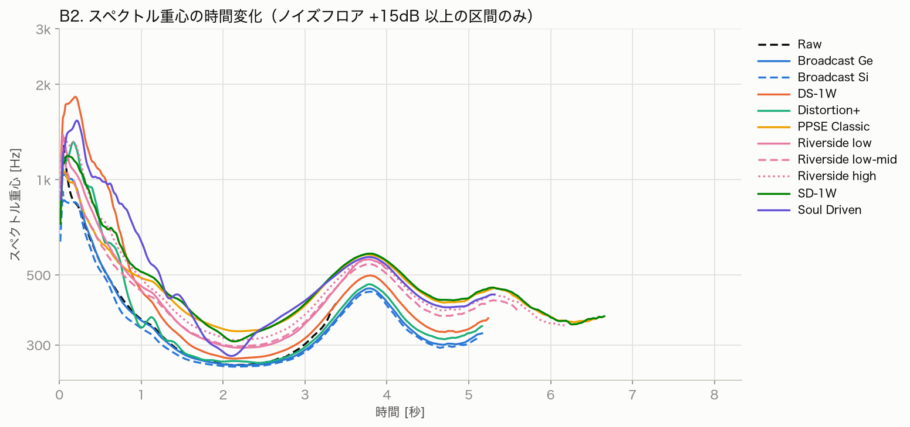

- 立ち上がり直後の重心は DS-1W（約 1.8kHz）と Soul Driven（約 1.5kHz）が高い
- 立ち上がりから 1 秒間の平均重心：DS-1W 1038Hz、Soul Driven 1020Hz、Riverside high 813Hz、SD-1W 791Hz、Distortion+ 751Hz、Riverside low 731Hz、PPSE Classic 676Hz、Riverside low-mid 664Hz、Broadcast Ge 598Hz、Raw 589Hz、Broadcast Si 543Hz
- 2 秒以降は、中域を持ち上げるペダル（SD-1W、PPSE Classic、Riverside、Soul Driven）の重心が高い。Broadcast と Distortion+ は Raw に近く、立ち上がり直後の重心が最も高かった DS-1W も Raw に近づく
- 3.8 秒付近の山は全ファイルに共通している。録音時に Orion のエコーはオフだったため、演奏（弦の振動）によるものと考えられる

## C. ダイナミクス

### C1. 減衰カーブ

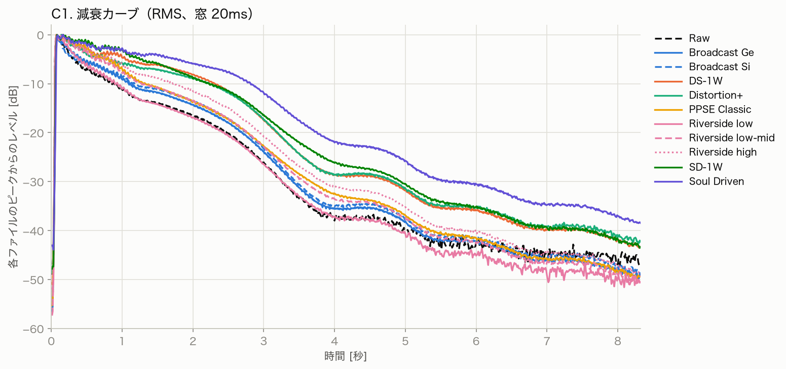

- Soul Driven が最も減衰が遅く、DS-1W、SD-1W、Distortion+ が続く
- Riverside low は Raw とほぼ重なる。Broadcast（Ge / Si）も Raw に近い

### C2〜C4. ダイナミクス指標

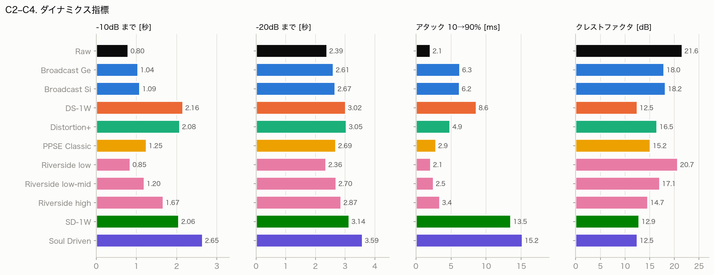

| ペダル | -10dB まで [秒] | -20dB まで [秒] | アタック [ms] | クレストファクタ [dB] |
|---|---:|---:|---:|---:|
| Raw | 0.80 | 2.39 | 2.1 | 21.6 |
| Broadcast Ge | 1.04 | 2.61 | 6.3 | 18.0 |
| Broadcast Si | 1.09 | 2.67 | 6.2 | 18.2 |
| DS-1W | 2.16 | 3.02 | 8.6 | 12.5 |
| Distortion+ | 2.08 | 3.05 | 4.9 | 16.5 |
| PPSE Classic | 1.25 | 2.69 | 2.9 | 15.2 |
| Riverside low | 0.85 | 2.36 | 2.1 | 20.7 |
| Riverside low-mid | 1.20 | 2.70 | 2.5 | 17.1 |
| Riverside high | 1.67 | 2.87 | 3.4 | 14.7 |
| SD-1W | 2.06 | 3.14 | 13.5 | 12.9 |
| Soul Driven | **2.65** | **3.59** | **15.2** | **12.5** |

- サステインとクレストファクタは同じ傾向を示す。圧縮が強いほど（クレストファクタが小さいほど）サステインが長い
- Riverside は、Mid Push をオンにすると（low → low-mid）、サステインが 0.85 秒から 1.20 秒に伸び、クレストファクタが 20.7dB から 17.1dB に下がる。High/Low トグルを High にすると（low → high）、サステインは 1.67 秒、クレストファクタは 14.7dB になり、変化はさらに大きい
- アタックは SD-1W と Soul Driven がなだらか。Riverside と PPSE Classic は、歪ませても Raw と同じくらい鋭いアタックを保つ

## D. 歪みの性質（倍音）

### D1, D2. 倍音ごとのレベル

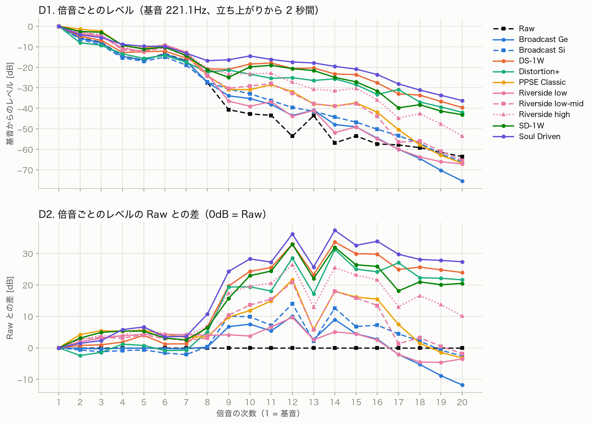

- 2〜8 次（約 1.8kHz まで）は、ほとんどのペダルで Raw との差が ±6dB 以内。この帯域は Raw にもともとある倍音（ギターと録音経路による）が大きく、ペダルの差が出にくい
- 9 次以上でペダルの差が大きく開く
  - +20〜37dB：Soul Driven、DS-1W、SD-1W、Distortion+
  - +13〜26dB：Riverside high
  - +10〜22dB（16 次を超えると Raw に近づく）：PPSE Classic、Riverside low-mid
  - +3〜14dB：Broadcast（Ge / Si）、Riverside low
- 12 次と 14 次で差が大きく見えるのは、Raw のこの 2 つの倍音がもともと小さいため

### D3. 倍音の指標

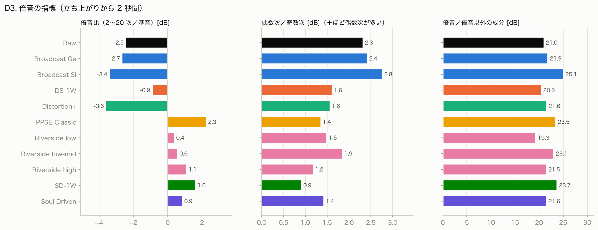

| ペダル | 倍音比 [dB] | 偶数次／奇数次 [dB] | 倍音／倍音以外 [dB] |
|---|---:|---:|---:|
| Raw | -2.5 | 2.3 | 21.0 |
| Broadcast Ge | -2.7 | 2.4 | 21.9 |
| Broadcast Si | -3.4 | 2.8 | 25.1 |
| DS-1W | -0.9 | 1.6 | 20.5 |
| Distortion+ | -3.6 | 1.6 | 21.6 |
| PPSE Classic | 2.3 | 1.4 | 23.5 |
| Riverside low | 0.4 | 1.5 | 19.3 |
| Riverside low-mid | 0.6 | 1.9 | 23.1 |
| Riverside high | 1.1 | 1.2 | 21.5 |
| SD-1W | 1.6 | 0.9 | 23.7 |
| Soul Driven | 0.9 | 1.4 | 21.6 |

- 倍音比は 2〜4 次（Raw にもともとある倍音）でほぼ決まるため、この素材では歪みの強さの指標に向かない。例えば、歪みの強い Distortion+ の値が最も小さい
- 偶数次／奇数次は Raw が 2.3dB。Broadcast（Ge / Si）は Raw と同じかやや偶数次寄り、それ以外のペダルは奇数次寄り（0.9〜1.9dB）。SD-1W が最も奇数次寄り。ただし差は小さく、Raw にもともとある倍音の影響が大きい
- 倍音／倍音以外の成分は 19〜25dB。Broadcast Si の値が最も大きく、倍音がきれいに並んでいる。倍音以外の成分には 110Hz の共鳴やノイズも含まれるため、歪みの粗さだけを表す値ではない

## E. ノイズ

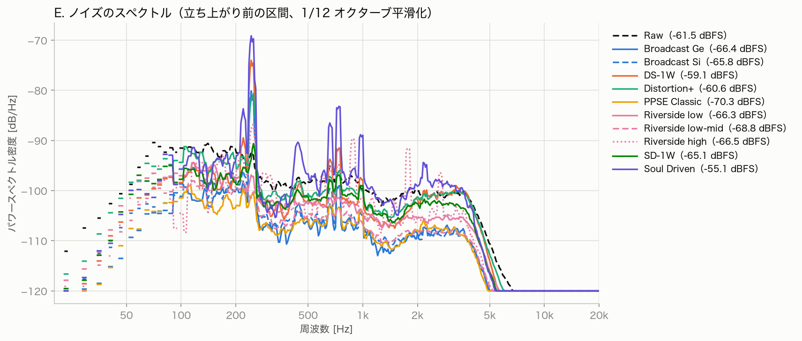

| ペダル | ノイズフロア [dBFS] | ヒス 2–5kHz [dB] | ハム [dB] |
|---|---:|---:|---:|
| Raw | -61.5 | -67.2 | 2.3 |
| Broadcast Ge | -66.4 | -74.8 | 2.3 |
| Broadcast Si | -65.8 | -75.4 | 2.3 |
| DS-1W | -59.1 | -67.2 | 4.7 |
| Distortion+ | -60.6 | -67.4 | 2.1 |
| PPSE Classic | -70.3 | -74.7 | 2.4 |
| Riverside low | -66.3 | -72.1 | 2.6 |
| Riverside low-mid | -68.8 | -74.9 | 2.3 |
| Riverside high | -66.5 | -70.2 | 4.6 |
| SD-1W | -65.1 | -69.6 | 3.9 |
| Soul Driven | **-55.1** | **-65.7** | 3.4 |

各ファイルはピークが同程度になるように調整してあるため、ノイズフロアの値は「ピークに対するノイズの大きさ」を表す。

- ピークに対するノイズは Soul Driven が最も大きく、DS-1W、Distortion+ が続く
- ヒスが小さいのは Broadcast（Ge / Si）、PPSE Classic、Riverside low-mid
- ハムの値（50/60Hz 系のピークが周囲を上回る量）は全ファイルで 5dB 未満で、目立つハムはない
- 240Hz 付近や 700Hz〜1kHz のピークは、立ち上がり前の区間に入っている弦の共鳴など演奏の音で、ペダルのノイズではない
- Raw のノイズフロアが多くのペダルより高い。ペダルを通さない Raw は出力が小さく、ピークを揃えるために持ち上げた分、録音経路のノイズも大きくなったと考えられる。ノイズフロアには、ペダル自体のノイズのほか、録音経路のノイズとゲイン調整の影響が含まれる。ペダル単体のノイズ量ではなく、ピークを揃えた状態での相対比較として扱う

## F. 総合的な類似度

### F1. 距離行列

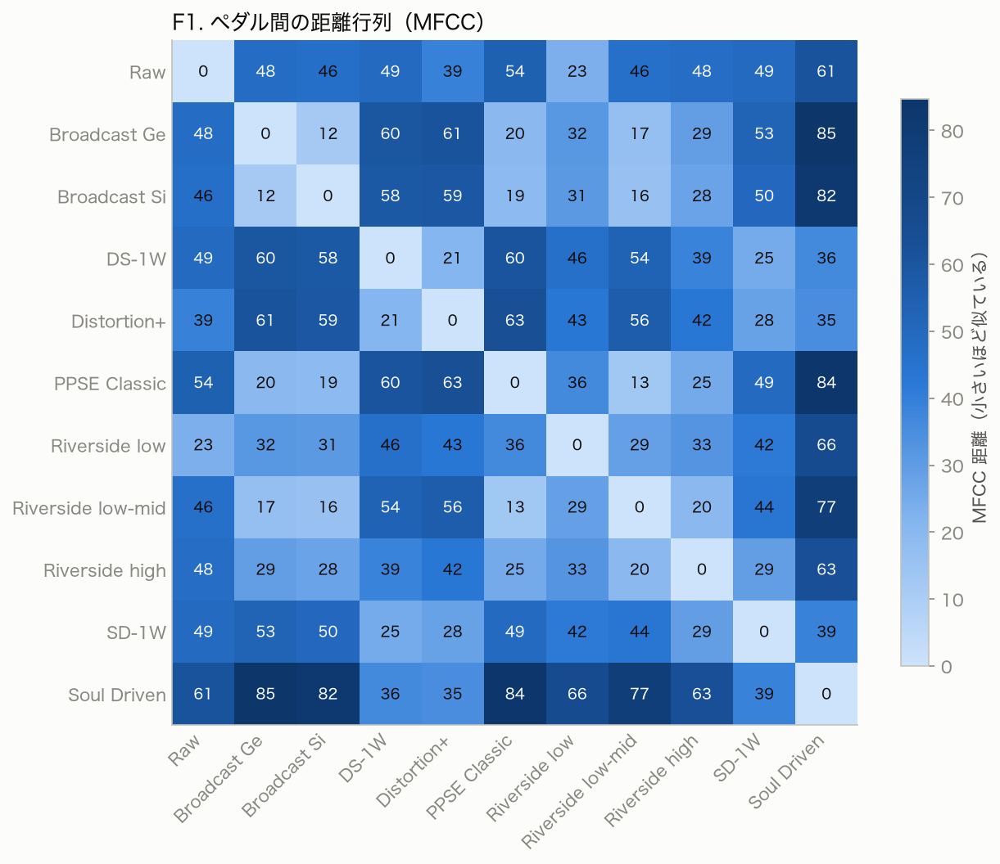

- 最も近い組み合わせ：Broadcast Ge – Si（12）、PPSE Classic – Riverside low-mid（13）
- 最も遠い組み合わせ：Soul Driven – Broadcast Ge（85）、Soul Driven – PPSE Classic（84）
- Raw に最も近いのは Riverside low（23）

### F2. 系統分け

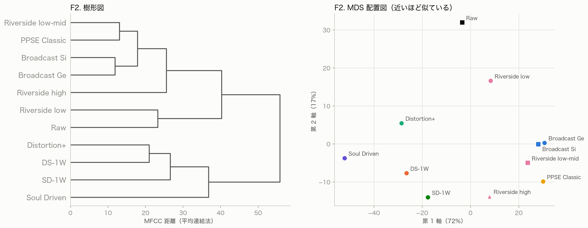

- 樹形図では、大きく 2 つに分かれる
  - 低〜中ゲイン：Broadcast（Ge / Si）、PPSE Classic、Riverside（3 設定）、Raw
  - 高ゲイン：DS-1W、Distortion+、SD-1W、Soul Driven
- MDS の配置図は、11 ファイル同士の距離を平面に写したもので、距離の違いの約 9 割を再現している（第 1 軸で 72%、第 2 軸で 17%）。残りの約 1 割は図に表れないため、図の上では本当の距離より近く見える組み合わせがある（例：Broadcast Ge と Si は本当の距離 12 に対し、図の上では約 3。PPSE Classic と Riverside low-mid は 13 に対し約 8）。具体的な近さは、F1 の距離行列の数値で確かめる
- 軸は特定の測定値を表すものではないため、各ファイルの座標と測定値の相関から意味を読んだ。11 ファイルでの相関なので、目安として扱う
  - 第 1 軸は歪みの量に当たる。左ほどサステインが長く（相関 -0.83）、1 秒間の平均重心が高い（-0.79）。250–500Hz の割合は右ほど大きい（0.81）。ノイズフロアとの相関（-0.90）も強いが、ゲインの高いペダルほどノイズも大きいためと考えられる
  - 第 2 軸は圧縮の弱さに当たる。上ほどクレストファクタが大きく（0.84）、圧縮のほとんどない Raw と Riverside low が上に離れる。下には 500Hz–1k の割合が大きいペダル（SD-1W、Riverside high、PPSE Classic）が集まる（-0.62）
- Soul Driven は高ゲインのグループの中でも離れており、ほかのペダルと似ていない

### F3. 区間ごとの距離

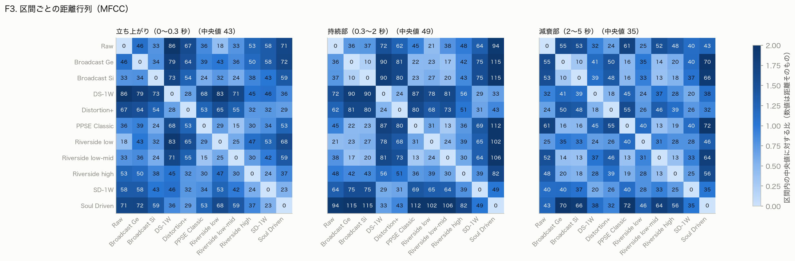

聴感では Broadcast の音がほかとかなり違うのに、ファイル全体の距離（F1）では Riverside low-mid に近かった。そこで、音を 3 つの区間に分けて距離を求めた。区間ごとに距離の大きさが違うため、全組み合わせの中央値と比べて読む。

| 区間 | 中央値 | Broadcast Ge に最も近いペダル | Broadcast Si に最も近いペダル | PPSE Classic と Riverside low-mid |
|---|---:|---|---|---:|
| 立ち上がり（0〜0.3 秒） | 43 | Riverside low-mid（36） | Riverside low-mid、PPSE Classic（24） | 15 |
| 持続部（0.3〜2 秒） | 49 | Riverside low-mid（17） | Riverside low-mid（20） | 13 |
| 減衰部（2〜5 秒） | 35 | Riverside low-mid（14） | Riverside low-mid（13） | 13 |

Broadcast に最も近いペダルは、Ge / Si の組み合わせを除いて数えた。

- Broadcast Ge の立ち上がりは、最も近いペダルとの距離（36）が中央値（43）に近く、ほかのどのペダルとも似ていない。持続部と減衰部では Riverside low-mid に近い
- ファイル全体の距離（F1）は時間の長い持続部と減衰部の影響が大きく、Broadcast の立ち上がりの違いが薄まっていた
- Broadcast Si の立ち上がりは、Ge ほどではないものの、持続部・減衰部より相対的に離れている（中央値に対する比で 0.56。持続部 0.41、減衰部 0.36）
- PPSE Classic と Riverside low-mid は、どの区間でも近い

## 解析の限界

- ペダルごとに 1 つの設定、1 回の録音：全ペダルのゲインと EQ のつまみを 12 時に揃えた。ただし、12 時で得られる歪みの量や EQ の効き方はペダルごとに違う。結果は「つまみが 12 時のときの各ペダルの特性」として読む。つまみの位置を変えると、結果は大きく変わりうる
- 単音 1 つ：別の音程や和音、強さを変えた演奏では、違う傾向が出る可能性がある
- 倍音に Raw にもともとある倍音が含まれる：Raw の音にも、ギターの倍音と、録音経路（Simplifier MK-II、Orion のプリアンプ）による色付けが含まれる。ペダル単体の歪み特性（偶数次・奇数次の比率、入力レベルと歪みの関係など）を正確に測るには、サイン波や対数スイープを同じ設定で通して録音する必要がある
- 5〜6kHz より上がカットされている：歪みペダルの特徴が出やすい高域のざらつきは評価できていない
- MFCC 距離はスペクトルの大まかな形を比べる指標：倍音の並び方の細かな違いは反映されにくい。また、ファイル全体で平均すると立ち上がりの違いが薄まる（F3）。聴感との食い違いがあれば、聴感と区間ごとの距離もあわせて判断する
