# ペダルごとの分析（pedals）

Updated: 2026-11-16

[analysis.md](analysis.md) の解析結果を、ペダルごとにまとめ直したもの。測定方法は [analysis-plan.md](analysis-plan.md) を参照。各ペダルの節は、測定結果と、それをもとにした音楽的な推察に分けて書いた。最後に、ペダルの近さマップと、残す優先度をまとめた。見出しは正式名、図表と本文は短縮名で書く（対応は [pre-process.md の「対象ペダルと表記」](pre-process.md#対象ペダルと表記) を参照）。

- スクリプト：`tools/pedal_profiles.py`（指標の計算は `tools/analyze.py` と共通）
- 図：`docs/figures/pedals/*.png`
- 順位の一覧：`docs/pedal_ranks.csv`

```sh
uv run --with numpy --with scipy --with soundfile --with matplotlib --with librosa python tools/pedal_profiles.py
```

## 図と表の見方

各ペダルの図は 4 つのグラフからなる。そのペダルを色付きの太線、Raw を黒の破線、ほかのペダルを灰色の細線で表示し、全体の中での位置が分かるようにした。

| グラフ | 見るところ |
|---|---|
| スペクトルの Raw との差（左上） | 全体のパワーを揃えたうえでの差。0dB より上は Raw より強い帯域、下は弱い帯域 |
| 減衰カーブ（右上） | 線が上にあるほどサステインが長い |
| 倍音ごとのレベルの Raw との差（左下） | ペダルが加えた倍音。差が出るのは主に 9 次（約 2kHz）以上 |
| スペクトル重心の時間変化（右下） | 線が上にあるほど、相対的に高域の割合が大きい。高域が増えた場合だけでなく、低域が減った場合も上がる |

表の「順位」は、Raw を除く 10 台の中での順位で、各指標の 1 位の意味は次のとおり。

| 指標 | 1 位の意味 | 使った値 |
|---|---|---|
| サステイン | 最も長い | ピークから -10dB に下がるまでの時間 |
| 圧縮 | 最も強い | 立ち上がりから 2 秒間のクレストファクタ（小さいほど圧縮が強い） |
| アタック | 最もなだらか | 10% から 90% に上がるまでの時間 |
| 重心 | 最も高い | 立ち上がりから 1 秒間の平均スペクトル重心 |
| 高次倍音 | 最も多い | 9〜20 次の倍音レベルの Raw との差の平均 |
| ノイズ | 最も大きい | 立ち上がり前の区間のノイズフロア（ピークを揃えてあるため、ピークに対するノイズの大きさ） |

### 「音楽的な推察」について

- 測定値から、演奏や音作りでどう働きそうかを推し量ったもの。**実際に聴いて確かめた評価ではない**
- 推察ごとに、根拠にした指標と数値を添えた
- 単音 1 つ、各ペダル 1 つの設定（ゲインと EQ のつまみは 12 時）、5〜6kHz より上がカットされた録音に基づくため、実際の演奏や設定では違って聞こえる可能性がある。聴いて確かめる際の手がかりとして使う

## 一覧

| ペダル | サステイン | 圧縮 | アタック | 重心 | 高次倍音 | ノイズ | 近いペダル |
|---|---:|---:|---:|---:|---:|---:|---|
| [Broadcast Ge](#hudson-electronics-broadcast-ap-iigermanium) | 9 | 8 | 4 | 9 | 10 | 7 | Broadcast Si |
| [Broadcast Si](#hudson-electronics-broadcast-ap-iisilicon) | 8 | 9 | 5 | 10 | 8 | 5 | Broadcast Ge |
| [DS-1W](#boss-ds-1ws-mode) | 2 | 1 | 3 | 1 | 2 | 2 | Distortion+ |
| [Distortion+](#mxr-distortion) | 3 | 6 | 6 | 5 | 4 | 3 | DS-1W |
| [PPSE Classic](#vin-antique-ppse-classic) | 6 | 5 | 8 | 7 | 6 | 10 | Riverside low-mid |
| [Riverside low](#strymon-riversidelow) | 10 | 10 | 10 | 6 | 9 | 6 | Riverside low-mid |
| [Riverside low-mid](#strymon-riversidelow--mid-push) | 7 | 7 | 9 | 8 | 7 | 9 | PPSE Classic |
| [Riverside high](#strymon-riversidehigh) | 5 | 4 | 7 | 3 | 5 | 8 | Riverside low-mid |
| [SD-1W](#boss-sd-1ws-mode) | 4 | 3 | 2 | 4 | 3 | 4 | DS-1W |
| [Soul Driven](#xotic-soul-driven) | 1 | 2 | 1 | 2 | 1 | 1 | Distortion+ |

---

## Hudson Electronics Broadcast AP-II（Germanium）

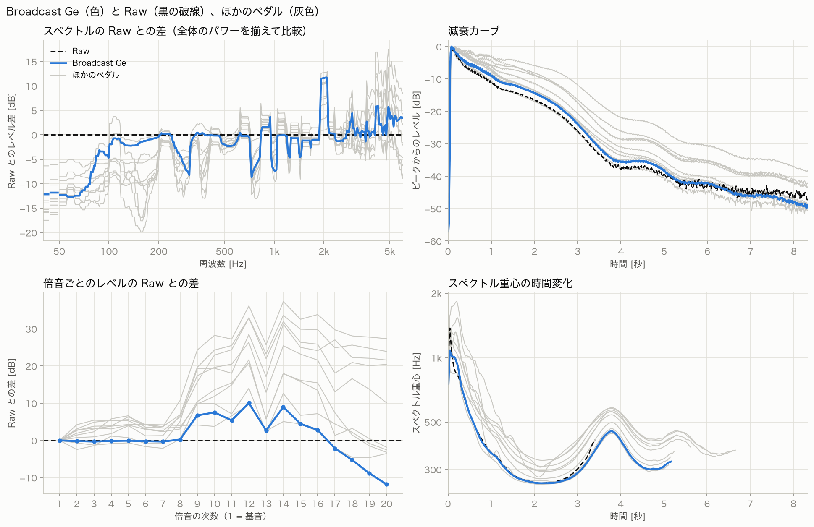

### 測定結果

| 指標 | 値 | 順位 |
|---|---:|---:|
| サステイン（-10dB まで） | 1.04 秒（Raw 0.80） | 9 |
| クレストファクタ | 18.0dB（Raw 21.6） | 8 |
| アタック | 6.3ms（Raw 2.1） | 4 |
| 1 秒間の平均重心 | 598Hz（Raw 589） | 9 |
| 9〜20 次倍音の増加 | +1.7dB | 10 |
| ノイズフロア | -66.4dBFS | 7 |

帯域別エネルギー比：<250Hz 48.0%、250–500Hz 24.8%、500–1k 9.2%、1k–2k 10.2%、2k–5k 7.9%

- **10 台の中で最も歪みが少ない。** 9〜20 次倍音の増加は 10 台中最小で、17 次より上は Raw より小さい
- 音色のバランスは Raw に最も近い。80Hz より下を約 12dB 削り、100〜500Hz は Raw とほぼ同じ（平均 -1.4dB）
- スペクトル重心は Raw とほぼ同じで、減衰しても重心の動きが Raw と重なる
- 立ち上がりの瞬間だけ 7〜12kHz の成分が出る（10 台の中でこのペダルだけ）
- アタックは 6.3ms で、Raw より少し丸くなる
- 近いペダル：Broadcast Si（距離 12）、Riverside low-mid（17）
- 区間ごとに見ると、立ち上がり（0〜0.3 秒）はほかのどのペダルとも似ていない。Si を除いて最も近い Riverside low-mid でも距離 36 で、全組み合わせの中央値（43）に近い。ファイル全体の距離が近いのは、持続部と減衰部が Riverside low-mid に近いため（[analysis.md の F3](analysis.md#f3-区間ごとの距離)）

### 音楽的な推察

- 音色を大きく変えずに、わずかな歪みとサステインを足す使い方（軽いブースト、ほかの歪みペダルの前段）に向くと考えられる
  - 根拠：9〜20 次倍音の増加が +1.7dB で 10 台中最小。帯域バランスが Raw に最も近い
- ピッキングの強弱が出音に反映されやすいと考えられる
  - 根拠：クレストファクタ 18.0dB で、Raw（21.6dB）からの低下が小さい（圧縮が弱い）
- 低音弦の膨らみを抑える方向に音色を変えると考えられる
  - 根拠：80Hz より下が約 -12dB、100〜500Hz は Raw とほぼ同じ
- Riverside では代わりがききにくいと考えられる。低域を保ったまま軽く歪ませ、立ち上がりに独特の特徴を持つ役割は、ほかのペダルにない
  - 根拠：立ち上がりの距離がどのペダルとも中央値に近い。低域の割合 48.0% に対し、Riverside low-mid は 33.6%。録音者の試聴でも、ほかのペダルとかなり違って聞こえた
- 立ち上がりの瞬間の 7〜12kHz の成分は、ピッキングの瞬間を強調して聞かせる可能性がある。ただし由来（ペダルの特性か、録音時のノイズか）を確認できていないため、判断を保留する

## Hudson Electronics Broadcast AP-II（Silicon）

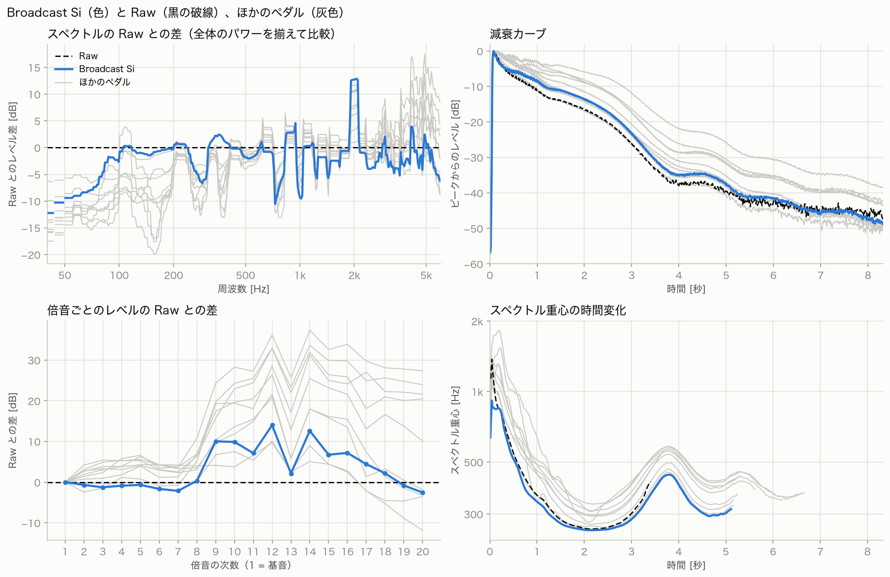

### 測定結果

| 指標 | 値 | 順位 |
|---|---:|---:|
| サステイン（-10dB まで） | 1.09 秒（Raw 0.80） | 8 |
| クレストファクタ | 18.2dB（Raw 21.6） | 9 |
| アタック | 6.2ms（Raw 2.1） | 5 |
| 1 秒間の平均重心 | 543Hz（Raw 589） | 10 |
| 9〜20 次倍音の増加 | +6.1dB | 8 |
| ノイズフロア | -65.8dBFS | 5 |

帯域別エネルギー比：<250Hz 52.8%、250–500Hz 24.5%、500–1k 9.2%、1k–2k 8.7%、2k–5k 4.8%

- **スペクトル重心が 10 台の中で最も低い。** 1 秒間の平均重心が Raw より低い唯一のペダルで、2–5kHz の比率も最も小さい。相対的に低域の割合が大きい
- 歪みは少なく、サステインと圧縮は Ge とほぼ同じ
- Ge と比べると、9〜16 次の倍音がおおむね 2〜4dB 多い。一方、2–5kHz の帯域は少なく、低域が多い
- 偶数次／奇数次の比（2.8dB）と、倍音／倍音以外の成分の比（25.1dB）はどちらも 11 ファイル中で最大。倍音以外の成分が相対的に少ない
- 近いペダル：Broadcast Ge（距離 12）、Riverside low-mid（16）
- 区間ごとに見ると、立ち上がりは持続部・減衰部より相対的に離れる。Ge を除いて最も近い Riverside low-mid と PPSE Classic でも距離 24（中央値 43）。持続部は 20（中央値 49）、減衰部は 13（中央値 35）

### 音楽的な推察

- Ge と同じく、軽いドライブやブーストの用途に向くと考えられる
  - 根拠：サステイン、圧縮、高次倍音が Ge とほぼ同じ
- 耳に刺さる高域の成分が少なく、濁りも少ないため、高域を抑えたいクランチやクリーン寄りの音作りに合う可能性がある
  - 根拠：2–5kHz の割合が 4.8% で 10 台中最小。倍音／倍音以外の成分の比が 25.1dB で最大
- 一方、バンドの中では高域側で埋もれやすい可能性がある
  - 根拠：同上
- Ge と Si のどちらを選ぶかは、主に高域の量で決まると考えられる
  - 根拠：両者の距離は 12 で全組み合わせ中最小。主な差は 2–5kHz の割合（Ge 7.9%、Si 4.8%）

## BOSS DS-1W（S-mode）

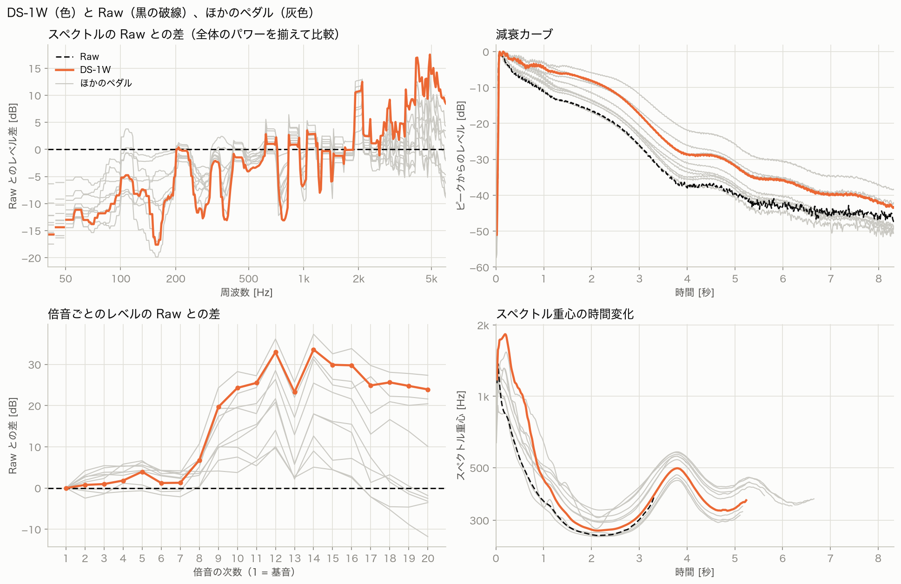

### 測定結果

| 指標 | 値 | 順位 |
|---|---:|---:|
| サステイン（-10dB まで） | 2.16 秒（Raw 0.80） | 2 |
| クレストファクタ | 12.5dB（Raw 21.6） | 1 |
| アタック | 8.6ms（Raw 2.1） | 3 |
| 1 秒間の平均重心 | 1038Hz（Raw 589） | 1 |
| 9〜20 次倍音の増加 | +26.5dB | 2 |
| ノイズフロア | -59.1dBFS | 2 |

帯域別エネルギー比：<250Hz 43.2%、250–500Hz 18.3%、500–1k 11.0%、1k–2k 11.9%、2k–5k 15.6%

- **スペクトル重心が 10 台の中で最も高く、圧縮も最も強い。** 2–5kHz の比率は Raw の約 2 倍で、4.9kHz 付近を最大 +17.5dB 持ち上げる
- 250–500Hz が少なく、中低域を抑えて高域を強調する
- 重心が高いのは立ち上がり直後に限られる。直後の重心は約 1.8kHz と全ペダルで最も高いが、2 秒以降は Raw や Broadcast と同じくらいまで下がる
- 倍音／倍音以外の成分の比（20.5dB）は Raw より低く、倍音以外の成分がやや多い
- 近いペダル：Distortion+（距離 21）、SD-1W（25）

### 音楽的な推察

- 歪みを前面に出すハイゲインのリフやパワーコード向きと考えられる
  - 根拠：圧縮 1 位、高次倍音の増加 2 位
- バンドの中では高域側で抜けやすい一方、単体では音が細く聞こえる可能性がある
  - 根拠：2–5kHz の割合が 15.6% で最大、250–500Hz が 18.3% と少ない
- ピッキングの瞬間が強調され、伸ばした音は落ち着いて聞こえると推察される
  - 根拠：立ち上がり直後の重心が約 1.8kHz で最も高く、2 秒以降は Raw 程度まで下がる
- 録音や静かなパートでは、ノイズゲートの併用を検討する価値がある
  - 根拠：ピークに対するノイズ（-59.1dBFS）が 2 番目に大きい

## MXR Distortion+

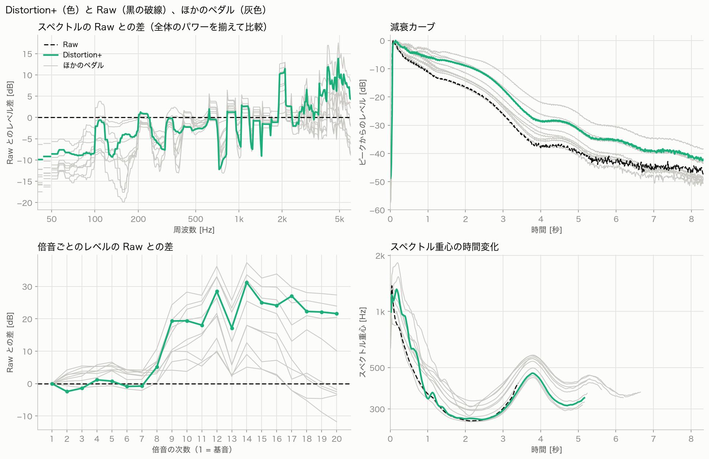

### 測定結果

| 指標 | 値 | 順位 |
|---|---:|---:|
| サステイン（-10dB まで） | 2.08 秒（Raw 0.80） | 3 |
| クレストファクタ | 16.5dB（Raw 21.6） | 6 |
| アタック | 4.9ms（Raw 2.1） | 6 |
| 1 秒間の平均重心 | 751Hz（Raw 589） | 5 |
| 9〜20 次倍音の増加 | +23.0dB | 4 |
| ノイズフロア | -60.6dBFS | 3 |

帯域別エネルギー比：<250Hz 56.0%、250–500Hz 15.2%、500–1k 8.6%、1k–2k 10.7%、2k–5k 9.5%

- **低域が 10 台の中で最も多く、250–500Hz が最も少ない。** 中低域を削った、低域と高域が目立つ音
- サステインは長い（3 位）。一方、立ち上がりから 2 秒間のクレストファクタは中程度で、アタックのピークを比較的残している
- 高次の倍音は DS-1W や SD-1W と同じくらい多い
- 高ゲインのペダルの中では Raw に最も近い（距離 39）
- 近いペダル：DS-1W（距離 21）、SD-1W（28）

### 音楽的な推察

- 中低域が少なく低域と高域が出る、いわゆるドンシャリ寄りの音と考えられる。単体では迫力が出やすいが、バンドの中ではベースと低域がぶつかったり、ギターの帯域が埋もれたりする可能性がある
  - 根拠：低域（<250Hz）56.0% で最大、250–500Hz 15.2% で最小
- 音を長く伸ばしながらも、ピッキングの粒立ちが残ると推察される。リードで表情を付けやすい可能性がある
  - 根拠：サステイン 3 位に対し、クレストファクタは 16.5dB で 6 位（アタックのピークが比較的残る）
- 圧縮の弱さは、ゲインの差ではなくペダル固有の性格と考えられる
  - 根拠：歪みの量は SD-1W とほぼ同じ（サステイン 2.08 秒と 2.06 秒、高次倍音 +23.0dB と +23.5dB）なのに、クレストファクタは 16.5dB と 12.9dB
- 高ゲインのペダルの中では、原音の傾向を残した歪みと考えられる
  - 根拠：高ゲインのペダルの中で Raw との距離が最小（39）

## Vin-Antique PPSE Classic

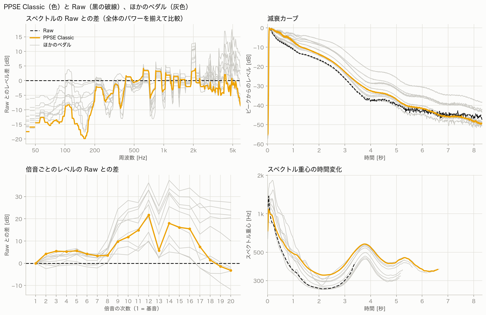

### 測定結果

| 指標 | 値 | 順位 |
|---|---:|---:|
| サステイン（-10dB まで） | 1.25 秒（Raw 0.80） | 6 |
| クレストファクタ | 15.2dB（Raw 21.6） | 5 |
| アタック | 2.9ms（Raw 2.1） | 8 |
| 1 秒間の平均重心 | 676Hz（Raw 589） | 7 |
| 9〜20 次倍音の増加 | +9.8dB | 6 |
| ノイズフロア | -70.3dBFS | 10 |

帯域別エネルギー比：<250Hz 26.9%、250–500Hz 34.7%、500–1k 19.2%、1k–2k 14.1%、2k–5k 5.1%

- **低域を最も削り、中低域から中域を持ち上げる。** 低域の比率は 10 台中最小で、150Hz 付近は約 -20dB と全ペダルで最も深く削れる。250–500Hz の比率は最大
- 高次の倍音は 9〜16 次で +10〜22dB 増えるが、18 次（約 4kHz）より上は Raw と同じくらいに戻る
- アタックは 2.9ms で、中程度に歪ませても Raw に近い鋭さを保つ
- ピークに対するノイズは 10 台の中で最も小さい
- 近いペダル：Riverside low-mid（距離 13）、Broadcast Si（19）
- Riverside low-mid とは、立ち上がり・持続部・減衰部のどの区間でも近い（距離 15 / 13 / 13）

### 音楽的な推察

- ベースとぶつかりにくく、ギターの帯域で前に出る音と考えられる。バンドの中でのリズムギター（クランチ〜オーバードライブ）に向く可能性がある
  - 根拠：低域の割合 26.9% で最小、150Hz 付近が約 -20dB、250–500Hz の割合 34.7% で最大
- ピッキングの強弱で歪みの量を操作しやすいと推察される
  - 根拠：アタック 2.9ms と鋭く、圧縮は中程度（クレストファクタ 15.2dB）
- 歪ませても耳に刺さる成分が増えにくいと考えられる
  - 根拠：18 次（約 4kHz）より上の倍音は Raw と同じくらいにとどまる
- ピークに対するノイズが小さいため、録音やダイナミクスの大きい曲で扱いやすい
  - 根拠：ノイズフロア -70.3dBFS で最も小さい

## Strymon Riverside（Low）

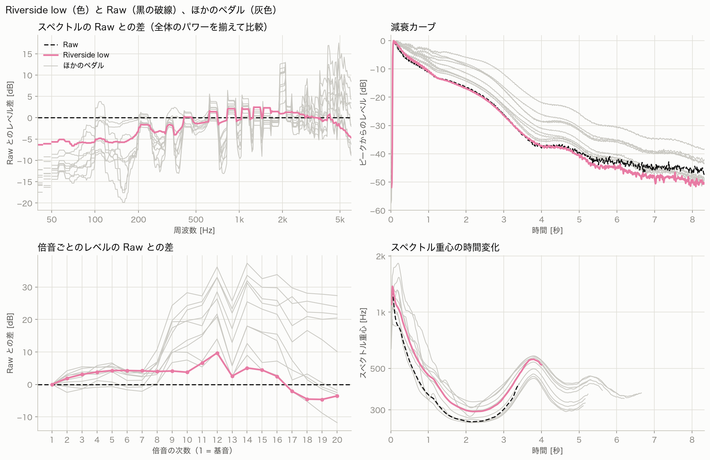

### 測定結果

設定：High/Low トグルは Low、Mid Push はオフ

| 指標 | 値 | 順位 |
|---|---:|---:|
| サステイン（-10dB まで） | 0.85 秒（Raw 0.80） | 10 |
| クレストファクタ | 20.7dB（Raw 21.6） | 10 |
| アタック | 2.1ms（Raw 2.1） | 10 |
| 1 秒間の平均重心 | 731Hz（Raw 589） | 6 |
| 9〜20 次倍音の増加 | +2.0dB | 9 |
| ノイズフロア | -66.3dBFS | 6 |

帯域別エネルギー比：<250Hz 31.2%、250–500Hz 26.5%、500–1k 12.6%、1k–2k 19.8%、2k–5k 9.9%

- **ダイナミクスは Raw とほぼ同じ。** サステイン、圧縮、アタックはいずれも 10 台中最も Raw に近く、減衰カーブは Raw と重なる
- 一方、音色は変わる。低域を減らし、1k–2kHz の比率は 10 台中最大。歪ませずに EQ で音色を整える使い方に近い
- 総合的にも Raw に最も近い（距離 23）
- 倍音／倍音以外の成分の比（19.3dB）は 11 ファイル中最小。ただし、歪みが少ないため 110Hz の共鳴やノイズの影響が相対的に大きいと考えられる
- 近いペダル：Riverside low-mid（距離 29）、Broadcast Si（31）

### 音楽的な推察

- 歪ませる用途より、クリーントーンの補正やアンプのキャラクター付けに向くと考えられる。常時オンにしておく使い方も考えられる
  - 根拠：サステイン、圧縮、アタックが Raw とほぼ同じ。帯域バランスだけが変わる
- 1k–2kHz は音の輪郭に関わる帯域とされ、ここが増えることで、バンドの中で音が聞き取りやすくなる可能性がある
  - 根拠：1k–2kHz の割合 19.8% で最大、低域の割合は Raw の 45.7% から 31.2% に減る

## Strymon Riverside（Low + Mid Push）

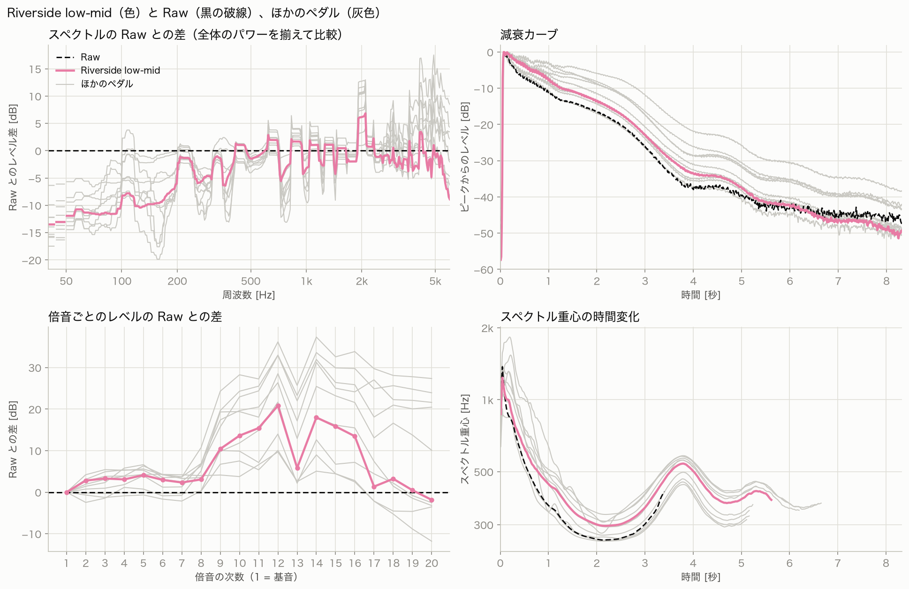

### 測定結果

設定：High/Low トグルは Low、Mid Push はオン

| 指標 | 値 | 順位 |
|---|---:|---:|
| サステイン（-10dB まで） | 1.20 秒（Raw 0.80） | 7 |
| クレストファクタ | 17.1dB（Raw 21.6） | 7 |
| アタック | 2.5ms（Raw 2.1） | 9 |
| 1 秒間の平均重心 | 664Hz（Raw 589） | 8 |
| 9〜20 次倍音の増加 | +9.7dB | 7 |
| ノイズフロア | -68.8dBFS | 9 |

帯域別エネルギー比：<250Hz 33.6%、250–500Hz 32.6%、500–1k 13.6%、1k–2k 13.6%、2k–5k 6.6%

- **PPSE Classic とよく似た音**（距離 13、全組み合わせの中で 2 番目に近い）。低域を減らして中低域を持ち上げる傾向、倍音の増え方、サステインがほぼ同じ
- 歪みは軽く〜中程度で、アタックの鋭さを保つ
- ピークに対するノイズは小さい（9 位）
- 近いペダル：PPSE Classic（距離 13）、Broadcast Si（16）

### 音楽的な推察

- PPSE Classic とほぼ同じ役割を担えると考えられる。どちらか一方で代用できる可能性がある
  - 根拠：両者の距離 13 は全組み合わせ中 2 番目に小さく、区間ごとに見てもどの区間でも近い。帯域バランス、倍音の増え方、サステインがほぼ同じ。違いは、PPSE Classic のほうが 150Hz 付近を深く削る点（約 -20dB と約 -10dB）
- 軽く〜中程度のクランチで、ピッキングの強弱に追従しやすいと推察される
  - 根拠：アタック 2.5ms、クレストファクタ 17.1dB

## Strymon Riverside（High）

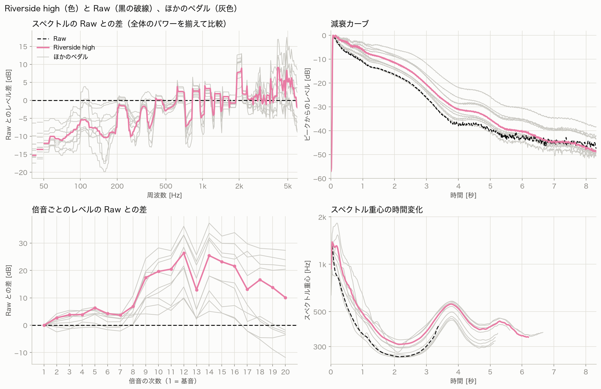

### 測定結果

設定：High/Low トグルは High、Mid Push はオフ

| 指標 | 値 | 順位 |
|---|---:|---:|
| サステイン（-10dB まで） | 1.67 秒（Raw 0.80） | 5 |
| クレストファクタ | 14.7dB（Raw 21.6） | 4 |
| アタック | 3.4ms（Raw 2.1） | 7 |
| 1 秒間の平均重心 | 813Hz（Raw 589） | 3 |
| 9〜20 次倍音の増加 | +18.4dB | 5 |
| ノイズフロア | -66.5dBFS | 8 |

帯域別エネルギー比：<250Hz 31.9%、250–500Hz 26.5%、500–1k 15.4%、1k–2k 16.7%、2k–5k 9.6%

- **10 台のちょうど中ほどの歪み**。サステイン、圧縮、高次倍音がいずれも 4〜5 位
- 中域から中高域（500Hz–2kHz）が多く、スペクトル重心は 3 位
- 歪みを強めてもアタックは 3.4ms で、鋭さを保つ
- Riverside の 3 設定の比較（基準は low）
  - Mid Push をオン（low-mid）：250–500Hz の割合が 26.5% → 32.6% に上がり、1k–2kHz が 19.8% → 13.6% に下がる。サステインは 0.85 → 1.20 秒、高次倍音は +2.0 → +9.7dB
  - High/Low を High（high）：帯域バランスはほとんど変わらない（各帯域の差は 3.1 ポイント以内）。サステインは 0.85 → 1.67 秒、高次倍音は +2.0 → +18.4dB と、Mid Push より大きく増える
- 近いペダル：Riverside low-mid（距離 20）、PPSE Classic（25）

### 音楽的な推察

- 中ゲインで、リフにもリードにも使える範囲と考えられる
  - 根拠：サステイン、圧縮、高次倍音がいずれも 10 台の中ほど（4〜5 位）
- 歪ませても速いフレーズの粒が立ちやすいと推察される
  - 根拠：アタック 3.4ms で、同程度に歪むペダルより鋭い
- Riverside は 2 つのトグルで、役割の違う変化を選べると考えられる。Mid Push は中低域を厚くしつつ軽く歪みを足し、High/Low は帯域バランスを保ったまま歪みの量を切り替える。1 台でクリーントーンの補正から中ゲインまでをカバーできる幅がある
  - 根拠：Mid Push で 250–500Hz が +6.1 ポイント、高次倍音が +7.7dB。High では帯域バランスの変化が 3.1 ポイント以内、高次倍音が +16.4dB

## BOSS SD-1W（S-mode）

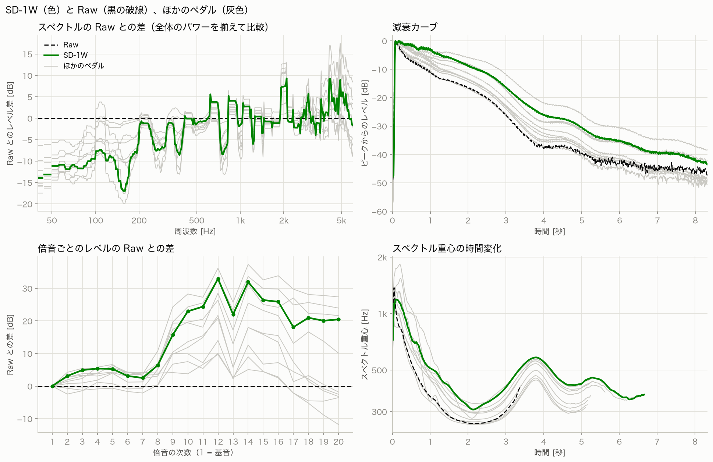

### 測定結果

| 指標 | 値 | 順位 |
|---|---:|---:|
| サステイン（-10dB まで） | 2.06 秒（Raw 0.80） | 4 |
| クレストファクタ | 12.9dB（Raw 21.6） | 3 |
| アタック | 13.5ms（Raw 2.1） | 2 |
| 1 秒間の平均重心 | 791Hz（Raw 589） | 4 |
| 9〜20 次倍音の増加 | +23.5dB | 3 |
| ノイズフロア | -65.1dBFS | 4 |

帯域別エネルギー比：<250Hz 34.7%、250–500Hz 25.1%、500–1k 21.3%、1k–2k 12.3%、2k–5k 6.6%

- **中域（500Hz–1k）の比率が 10 台中最大。** 低域を減らし、150Hz 付近を約 -17dB 削る。いわゆるミッドを持ち上げる TS 系に近い傾向
- アタックは 13.5ms と、Soul Driven に次いでなだらか
- 減衰しても重心が下がりにくい。2 秒以降の重心は、PPSE Classic と並んで全ペダルで最も高い
- 偶数次／奇数次の比（0.9dB）は 11 ファイル中最小で、相対的に奇数次の倍音が多い
- 近いペダル：DS-1W（距離 25）、Distortion+（28）

### 音楽的な推察

- 中域が前に出るため、バンドの中で埋もれにくく、リード向きと考えられる
  - 根拠：500Hz–1k の割合 21.3% で最大。低域を減らし、150Hz 付近が約 -17dB
- 低域を削る特性から、歪ませたアンプの前に置いたとき、低域の膨らみを抑えて輪郭を保つ使い方にも合う可能性がある
  - 根拠：同上
- 音の立ち上がりが丸く、ピッキングの硬さが和らぐと推察される。一方、速いフレーズでは音の粒立ちが弱くなる可能性がある
  - 根拠：アタック 13.5ms で 2 番目になだらか
- ロングトーンでも音が埋もれにくいと考えられる
  - 根拠：減衰しても重心が下がりにくく、2 秒以降の重心は PPSE Classic と並んで最も高い

## Xotic Soul Driven

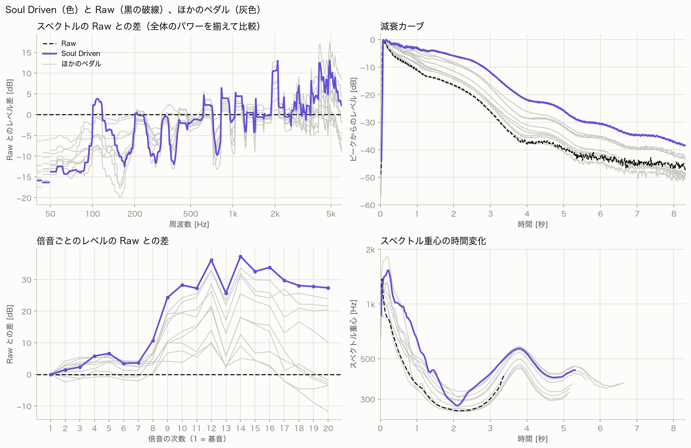

### 測定結果

| 指標 | 値 | 順位 |
|---|---:|---:|
| サステイン（-10dB まで） | 2.65 秒（Raw 0.80） | 1 |
| クレストファクタ | 12.5dB（Raw 21.6） | 2 |
| アタック | 15.2ms（Raw 2.1） | 1 |
| 1 秒間の平均重心 | 1020Hz（Raw 589） | 2 |
| 9〜20 次倍音の増加 | +29.9dB | 1 |
| ノイズフロア | -55.1dBFS | 1 |

帯域別エネルギー比：<250Hz 43.3%、250–500Hz 16.1%、500–1k 16.3%、1k–2k 14.2%、2k–5k 10.0%

- **10 台の中で最も歪みが強い。** サステイン、高次倍音、アタックのなだらかさがいずれも 1 位、圧縮が 2 位
- 250–500Hz を減らし、500Hz 以上を持ち上げる
- 110Hz 付近が Raw より約 3.5dB 強い。ほかのペダルはこの帯域が Raw より 0〜9dB 弱く、Soul Driven だけが目立つ。弾いていない 5 弦（開放 A）の共鳴を、高いゲインで強く拾っていると考えられる
- ピークに対するノイズは 10 台の中で最も大きい（-55.1dBFS、2 位の DS-1W より 4dB 大きい）
- **ほかのどのペダルとも似ていない。** 最も近い Distortion+ でも距離 35 で、Raw からの距離（61）も最大
- 近いペダル：Distortion+（距離 35）、DS-1W（36）

### 音楽的な推察

- ハイゲインのリードやロングトーン向きと考えられる
  - 根拠：サステイン 1 位（-10dB まで 2.65 秒）、高次倍音の増加 1 位
- ピッキングの強弱が出音に出にくく、なめらかにつながるレガートのフレーズに合う一方、カッティングのように歯切れが必要な演奏には向きにくい可能性がある
  - 根拠：アタック 15.2ms で最もなだらか、クレストファクタ 12.5dB（圧縮 2 位）
- 弾いていない弦のミュートとノイズ対策（ノイズゲートなど）が、ほかのペダルより重要になると考えられる
  - 根拠：110Hz 付近（開放 5 弦）が Raw より約 3.5dB 強く、ほかのペダルと逆の傾向。ピークに対するノイズ（-55.1dBFS）が最も大きい
- 音色（MFCC 距離）では、ほかのペダルと似ていない。ただし 1 位の指標（サステイン、高次倍音、アタックのなだらかさ）はいずれもゲインに連動するもので、ほかのペダルのゲインを上げれば近づく可能性がある（[残す優先度](#残す優先度)を参照）
  - 根拠：最も近い Distortion+ でも距離 35。Riverside を low から high に切り替えると、帯域の割合はほぼ変わらず（3.1 ポイント以内）、サステインと高次倍音は大きく増える

---

## まとめ：ペダルの近さマップ

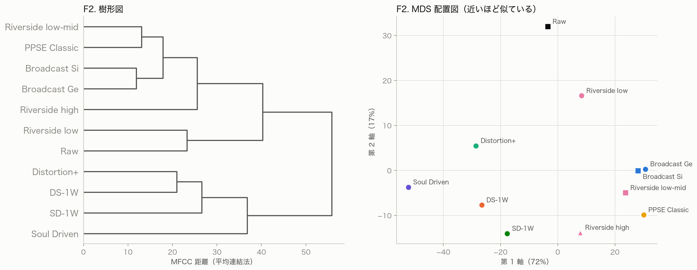

全体分析の F2 と同じ図。各ペダルの音の近さ（MFCC 距離。音量を表す 0 次は除く）を、樹形図（左）と 2 次元の配置図（右）で表した。配置図では、近くにあるペダルほど音が似ている。

配置図は、11 ファイル同士の距離を平面に写したもので、距離の違いの約 9 割を再現している（第 1 軸で 72%、第 2 軸で 17%）。残りの約 1 割は図に表れないため、図の上では本当の距離より近く見える組み合わせがある（例：Broadcast Ge と Si は本当の距離 12 に対し、図の上では約 3）。具体的な近さは、[analysis.md の F1](analysis.md#f1-距離行列) の距離行列の数値で確かめる。

- 大きく 2 つのグループに分かれる
  - 低〜中ゲイン：Broadcast Ge / Si、PPSE Classic、Riverside（3 設定）、Raw
  - 高ゲイン：DS-1W、Distortion+、SD-1W、Soul Driven
- 軸は特定の測定値を表すものではない。各ファイルの座標と測定値の相関から読むと、次のようになる（11 ファイルでの相関なので目安）
  - 横軸（第 1 軸）は歪みの量に当たる。左ほどサステインが長く（相関 -0.83）、1 秒間の平均重心が高い（-0.79）
  - 縦軸（第 2 軸）は圧縮の弱さに当たる。上ほどクレストファクタが大きく（0.84）、圧縮のほとんどない Raw と Riverside low が上に離れる。下には 500Hz–1k の割合が大きいペダル（SD-1W、Riverside high、PPSE Classic）が集まる
- 特に近い組み合わせは Broadcast Ge と Si（距離 12）、PPSE Classic と Riverside low-mid（13）
- Broadcast はこの図では Riverside low-mid の近くにあるが、立ち上がりだけを比べると、ほかのペダルから離れる（[analysis.md の F3](analysis.md#f3-区間ごとの距離)）
- Soul Driven はどのペダルからも離れている（最も近い Distortion+ でも距離 35）

## 残す優先度

測定結果と、録音者の試聴と判断をもとに、残すべきペダルの優先度を付けた。Broadcast（Ge / Si）と Riverside（3 設定）は、それぞれ 1 台として扱う。

基準は「**ゲインのつまみでは作れない特徴を持つものほど残す**」とした。

### 基準の考え方

指標を、ゲインに連動して変わるものと、ペダル固有でゲインでは変わりにくいものに分けた。残す理由になるのは後者だけとする。

| 種類 | 指標 | 根拠 |
|---|---|---|
| ゲインに連動して変わる | サステイン、圧縮、高次倍音の量、アタックのなだらかさ | Riverside を low から high に切り替えると、高次倍音が +2.0 → +18.4dB、サステインが 0.85 → 1.67 秒、クレストファクタが 20.7 → 14.7dB、アタックが 2.1 → 3.4ms と変わる |
| ペダル固有で、ゲインでは変わりにくい | 帯域の割合、同じくらいの歪みの量での圧縮の強さ | 同じ切り替えで、帯域の割合の変化は 3.1 ポイント以内にとどまる |

そのうえで、次の 3 点で判断した。

1. ゲインでは作れない特徴（帯域の割合、同じくらいの歪みの量での圧縮の強さ）を持つか
2. その特徴を、ほかのペダルが持っていないか
3. カバー範囲：1 台で複数の役割を担えるか

### 順位

| 順位 | ペダル | 最も近い別のペダル（距離） | 理由 |
|---:|---|---|---|
| 1 | Strymon Riverside | 設定により 13〜31 | 1 台でクリーントーンの補正（low）、軽いクランチ（low-mid）、中ゲイン（high）を担う。帯域の割合（Mid Push）と歪みの量（High/Low）を別々に切り替えられる。PPSE Classic の代わりにもなる |
| 2 | MXR Distortion+ | DS-1W（21） | 低域（<250Hz）の割合 56.0% で 10 台中最大。歪みの量は SD-1W とほぼ同じ（サステイン 2.08 秒と 2.06 秒、高次倍音 +23.0dB と +23.5dB）なのに、クレストファクタは 16.5dB と 12.9dB で、圧縮が弱い。どちらもゲインでは作りにくい |
| 3 | BOSS DS-1W | Distortion+（21） | 2–5kHz の割合 15.6% で 10 台中最大。ほかの 9 台はすべて 10% 以下 |
| 4 | Hudson Electronics Broadcast AP-II | Riverside low-mid（16〜17。立ち上がりでは Ge 36、Si 24） | 低域を保ったまま軽く歪ませる役割はほかにない。立ち上がりはほかのペダルと似ておらず、試聴でもほかとかなり違って聞こえた |
| 5 | Xotic Soul Driven（暫定） | Distortion+（35） | 1 位の指標（サステイン、高次倍音、アタックのなだらかさ。圧縮は 2 位）は、いずれもゲインに連動するもの。ほかのペダルのゲインを上げれば近づく可能性がある。ただし帯域の割合はどのペダルとも一致せず、検証の結果によっては順位が上がる（下記） |
| 6 | BOSS SD-1W | DS-1W（25） | 500Hz–1k の割合は 21.3% で最大だが、中域を持ち上げる傾向は Riverside high（15.4%）や PPSE Classic（19.2%）にもある。アタックがなだらかで圧縮が強い点はゲインに連動する特徴で、Soul Driven とも重なる。立ち上がりの距離は Riverside high と 24.0 で、中央値（43）よりかなり近い |
| 7 | Vin-Antique PPSE Classic | Riverside low-mid（13。どの区間でも 13〜15） | Riverside low-mid とほぼ同じ音。違いは 150Hz 付近の削り方くらい |

- Distortion+ と DS-1W は MFCC 距離が 21 と近いが、指標では反対の性質を持つ（低域の割合 56.0% と 43.2%、2–5kHz の割合 9.5% と 15.6%、クレストファクタ 16.5dB と 12.5dB）。MFCC 距離はスペクトルの大まかな形を比べる指標で、音量を表す 0 次を除いているため、圧縮の違いは反映されない。2 台を両方残すのはこのため
- Broadcast は、ファイル全体の距離だけで見ると Riverside low-mid に近く、優先度が低く見える。しかし立ち上がりの区間ではほかのペダルと似ておらず、試聴の評価とも合うため、4 位とした
- 前の版では、MFCC 距離での孤立と 1 位の指標の多さを重視し、Soul Driven を 2 位、SD-1W を 3 位、Distortion+ を 5 位、DS-1W を 6 位としていた。1 位の指標の多くがゲインに連動するものだったため、基準を改めた

### 検証していない前提

この順位は、次の 2 点を確かめていない。

- **帯域の割合がゲインで変わりにくいこと**：確かめたのは Riverside の 1 台だけ。歪みが増えると倍音によって高域側にエネルギーが移るため、帯域の割合も完全には固定されない。Distortion+ と DS-1W の順位もこの前提に立つ
- **Soul Driven がゲインを上げたほかのペダルで代えられること**：各ペダル 1 つの設定でしか録っていないため、確かめられない。Soul Driven の帯域の割合（低域 43.3%、500Hz–2k 30.5%、2–5kHz 10.0%）は、どのペダルとも一致しない。DS-1W は低域（43.2%）が近いが 2–5kHz が多く（15.6%）、SD-1W は 500Hz–2k（33.6%）が近いが低域が少ない（34.7%）。この割合をゲインでは作れない特徴とみなせば、Soul Driven の順位は上がる

確かめるには、Soul Driven のゲインを下げて録り、クレストファクタやサステインが DS-1W や SD-1W と同じくらいになる位置で、帯域の割合と区間ごとの距離を比べる。ゲインを下げても帯域の割合がほかと違ったままなら、Soul Driven の順位を上げる。1 回の録音で 2 つの前提をまとめて確かめられる。

この順位には、ノイズ（Soul Driven はピークに対するノイズが最も大きい）とつまみの設定（全て 12 時）は含めていない。外す候補は、聴き比べてから決める。

## 注意点

- 結果は各ペダル 1 つの設定（ゲインと EQ のつまみは 12 時）、単音 1 つの録音に基づく。12 時で得られる歪みの量はペダルごとに違い、つまみの位置を変えると順位も変わりうる
- 「音楽的な推察」は測定値からの推測で、聴感による評価ではない
- 倍音には、ギターと録音経路（DSM & Humboldt Simplifier MK-II、Orion のプリアンプ）による倍音が含まれるため、Raw との差で評価している
- 各ファイルは録音後にピークが同程度になるようゲインを調整してある。ノイズフロアは、ペダル自体のノイズのほか、録音経路のノイズとゲイン調整の影響を含む「ピークに対するノイズの大きさ」として扱う
- 詳しい限界は [analysis.md の「解析の限界」](analysis.md#解析の限界) を参照
